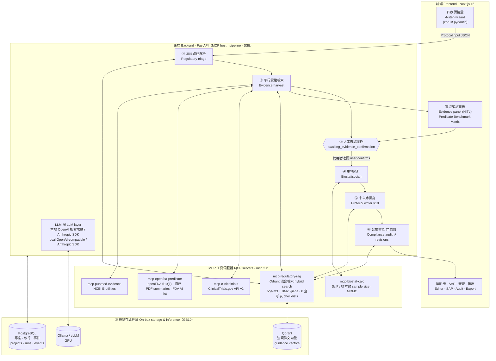

# AI-SaMD Clinical Protocol Copilot 🩺🤖

**基於 MCP 架構之智慧醫材（AI-SaMD）臨床試驗計畫書輔助草擬系統 — 可完整部署於單台 NVIDIA DGX Spark（GB10）。**
**MCP-powered clinical trial protocol generator for AI/ML-enabled medical devices — runs entirely on one NVIDIA DGX Spark (GB10).**

> 以 MCP 串接 ClinicalTrials.gov、FDA 510(k) / De Novo 摘要、PubMed 文獻基準與 TFDA / FDA / IMDRF 法規指引，搭配確定性生物統計與查核表驅動的合規審查（STARD-AI / SPIRIT-AI / ISO 14155），草擬符合法規要求的 AI 醫療器材軟體臨床試驗計畫書。
>
> An MCP-powered web system that drafts regulatory-grade clinical investigation plans for AI/ML-based Software as a Medical Device (AI-SaMD), grounded in ClinicalTrials.gov, FDA 510(k)/De Novo summaries, PubMed baselines and TFDA/FDA/IMDRF guidance, with deterministic biostatistics and checklist-driven compliance auditing (STARD-AI / SPIRIT-AI / ISO 14155).

[](#-測試--testing)  

---

## 📖 專案簡介 | Overview

為 AI/ML 醫療器材軟體撰寫符合 **TFDA、US FDA、ISO 14155** 與 **STARD-AI / SPIRIT-AI** 的臨床試驗計畫書，需要同時比對同類上市產品（predicate）的驗證設計、已登錄試驗與文獻基準，並正確推估樣本數。本系統把這個流程拆成 **五個確定性 MCP 工具伺服器 + 五個 LLM 代理（agent）**。

Writing a clinical investigation plan for AI/ML medical-device software that satisfies **TFDA, US FDA, ISO 14155** and **STARD-AI / SPIRIT-AI** means comparing predicate devices, registered trials and literature baselines while getting the sample size right. This system splits that work into **five deterministic MCP tool servers + five LLM agents**.

1. **結構化輸入 Structured input** — 使用者在網頁精靈填入四組資訊：器材與法規定位、AI 規格與人機流程、研究設計、評估指標與統計假設。  
   The user fills a four-step web wizard: device & regulatory profile, AI specifications & human–AI workflow, study design, endpoints & statistical assumptions.
2. **法規路徑解析 Regulatory triage** — 判定法規路徑、風險等級與適用查核表（例如 standalone 研究用 STARD-AI，而非 SPIRIT-AI）。  
   Determines the regulatory pathway, risk category and applicable checklists (e.g. STARD-AI, not SPIRIT-AI, for a standalone study).
3. **平行實證檢索 Evidence harvest** — 同時查詢 ClinicalTrials.gov、openFDA 與 510(k) 摘要 PDF、PubMed、法規條文索引，整理成「同類產品臨床設計基準矩陣」，**暫停等使用者勾選確認**（human-in-the-loop）。  
   Queries ClinicalTrials.gov, openFDA + 510(k) summary PDFs, PubMed and the guidance index in parallel, builds a *Predicate Benchmark Matrix* and **pauses for the user to confirm** (human-in-the-loop).
4. **生物統計 Biostatistics** — 呼叫 `mcp-biostat-calc`（SciPy，確定性）計算樣本數：精確二項效能目標、Buderer、AUROC、McNemar、Obuchowski–Rockette MRMC（Hillis 2011）。  
   Calls `mcp-biostat-calc` (SciPy, deterministic) for sample size: exact-binomial performance goals, Buderer, AUROC, McNemar, Obuchowski–Rockette MRMC (Hillis 2011).
5. **撰寫與審查 Writing & audit** — 依法規條文與實證平行撰寫十章節，再逐項對照查核表審查並退回修訂（最多兩輪）。  
   Drafts ten sections in parallel from guidance clauses and evidence, then audits them item by item against the checklists and sends failures back for revision (up to two rounds).
6. **編輯與匯出 Edit & export** — 雙欄編輯器修訂後匯出 Markdown / Word。  
   Review in a two-pane editor and export to Markdown / Word.

**所有數字只能來自工具輸出，所有引用只能來自檢索結果；無法支持的內容一律標記 `[TO BE CONFIRMED]`。**
**Every number must come from a tool output and every citation from retrieved evidence; anything unsupported is marked `[TO BE CONFIRMED]`.**

> 本專案源自一份以 Gemini 先行規劃的設計文件，逐條檢視後的修正紀錄見 [`docs/REVIEW.zh-TW.md`](docs/REVIEW.zh-TW.md)。
> The project started from a design draft written with Gemini; the item-by-item correctness review is in [`docs/REVIEW.zh-TW.md`](docs/REVIEW.zh-TW.md) (Chinese).

---

## 🏗️ 系統架構 | Architecture

完整說明（元件、狀態機、資料流與信任邊界、GB10 部署拓撲、LLM 層、設計取捨）見 **[`docs/ARCHITECTURE.md`](docs/ARCHITECTURE.md)**（中英對照）。
Full details — components, state machine, data flow and trust boundaries, GB10 deployment topology, LLM layer, design trade-offs — are in **[`docs/ARCHITECTURE.md`](docs/ARCHITECTURE.md)** (bilingual).

| 層 Layer | 元件 Components | 職責 Responsibility |
|---|---|---|
| 前端 Frontend | Next.js 16 · React 19 · Tailwind 4 | 四步驟精靈、實證確認面板、編輯器；同源代理 `/backend` 在伺服器端附上 API 金鑰<br/>Wizard, evidence-confirmation panel, editor; same-origin `/backend` proxy adds the API key server-side |
| 後端 Backend | FastAPI · SQLAlchemy · SSE | MCP host、五代理流程、狀態持久化、即時事件、匯出<br/>MCP host, five-agent pipeline, persisted state, live events, export |
| 工具層 MCP servers | 官方 `mcp` 2.x `MCPServer`，streamable HTTP<br/>Official `mcp` 2.x `MCPServer`, streamable HTTP | 確定性檢索與計算，不呼叫 LLM<br/>Deterministic retrieval and computation, no LLM calls |
| 儲存 Storage | PostgreSQL · Qdrant | 專案與執行紀錄；法規條文向量索引<br/>Projects and runs; guidance vector index |
| 推論 Inference | Ollama / vLLM / NIM（GB10 GPU）或 Anthropic API<br/>Ollama / vLLM / NIM (GB10 GPU) or the Anthropic API | 文字生成（chat）與向量嵌入（bge-m3）<br/>Text generation (chat) and embeddings (bge-m3) |



### 執行階段 | Pipeline stages

| 階段 Stage | 代理 Agent | 做什麼 What it does | MCP 工具 Tools |
|---|---|---|---|
| ① `triage` | Regulatory Triage | 判定研究型態、法規路徑、風險等級與適用查核表<br/>Study archetype, pathway, risk category, applicable checklists | `select_checklists`, `retrieve_guideline_clauses` |
| ② `harvest` | Evidence Harvester | 平行檢索四個來源並合成基準矩陣；查無結果時自動放寬條件<br/>Parallel search of four sources, benchmark matrix; broadens the query on zero results | `search_samd_trials`, `summarize_predicate_benchmarks`, `find_predicate_devices`, `search_fda_ai_device_list`, `search_baseline_performance`, `search_ai_evidence` |
| ③ `awaiting_evidence_confirmation` | — | 暫停，等使用者勾選採用的實證並可覆寫基準值<br/>Pauses for the user to accept evidence and override baselines | — |
| ④ `biostat` | Biostatistician | 確定性樣本數計算與分層配置，撰寫統計分析計畫<br/>Deterministic sample size and allocation, statistical analysis plan | `calc_*`, `allocate_strata` |
| ⑤ `write` | Protocol Writer | 依 ISO 14155 Annex A 結構平行撰寫十章；單章失敗以標記佔位，不中斷流程<br/>Ten sections in parallel (ISO 14155 Annex A); a failed section becomes a flagged placeholder | `retrieve_guideline_clauses` |
| ⑥ `audit` | Compliance Auditor | 關鍵字預篩 + LLM 逐項判定，退回修訂，最多兩輪<br/>Keyword pre-screen + LLM item judgement, revision loop, up to two rounds | `get_checklist`, `prescreen_checklist_coverage` |

### 與原始規劃的主要差異 | Key changes from the original plan

| 原規劃 Gemini draft | 本實作 This implementation |
|---|---|
| 所有研究一律用 SPIRIT-AI<br/>SPIRIT-AI for every study | 依設計選查核表：standalone / MRMC 用 **STARD-AI**，前瞻 RCT 用 **SPIRIT-AI + CONSORT-AI**，預後模型用 **TRIPOD+AI**；**ISO 14155 Annex A** 與 **IMDRF N41** 一律納入；依市場加 **TFDA** / **FDA CADe**<br/>Checklists chosen by design: **STARD-AI** (standalone / MRMC), **SPIRIT-AI + CONSORT-AI** (prospective RCT), **TRIPOD+AI** (prognostic); **ISO 14155 Annex A** + **IMDRF N41** always; **TFDA** / **FDA CADe** by market |
| 在 MCP 伺服器內用 LLM 檢查合規<br/>LLM-based compliance check inside an MCP server | 伺服器只做確定性關鍵字預篩，LLM 判定放在後端審查代理並有修訂迴圈<br/>Deterministic pre-screen in the server; LLM judgement in the backend auditor with a revision loop |
| `FastMCP`（mcp 1.x） | 官方 `mcp` 2.x 的 `MCPServer`，後端用 `mcp.client.client.Client`<br/>`MCPServer` from the official `mcp` 2.x SDK; `mcp.client.client.Client` on the host |
| 未規劃推論層<br/>No inference layer | 與供應商無關的 LLM 客戶端，預設接 GB10 本地 OpenAI 相容端點，具結構化輸出降級與截斷重試<br/>Provider-agnostic LLM client, default local OpenAI-compatible endpoint on the GB10, with structured-output fallbacks and truncation retry |
| 人工確認只是一個箭頭<br/>HITL as an arrow | 持久化的執行狀態機，`awaiting_evidence_confirmation` 為正式階段，重啟後可續跑<br/>Persisted run state machine with a real `awaiting_evidence_confirmation` stage, resumable after restart |

---

## 📂 目錄結構 | Repository layout

```
.
├── backend/                     # FastAPI：資料合約、LLM 層、MCP 客戶端、五代理、流程、匯出、測試
│   └── app/{schemas,llm,mcp_client,agents,api,db,exporters}   # schemas, LLM layer, MCP client, agents, pipeline, exporters
├── mcp-servers/
│   ├── mcp-biostat-calc/        # 確定性統計（13 工具） deterministic statistics (13 tools)
│   ├── mcp-clinicaltrials/      # ClinicalTrials.gov API v2（4 工具 tools）
│   ├── mcp-openfda-predicate/   # openFDA 510(k)、510(k)/De Novo 摘要 PDF、FDA AI 器材清單（6 工具 tools）
│   ├── mcp-pubmed-evidence/     # NCBI E-utilities、基準效能擷取、引用格式（5 工具 tools）
│   └── mcp-regulatory-rag/      # Qdrant 混合檢索、匯入工具、8 份查核表（6 工具） hybrid retrieval, ingestion, 8 checklists
├── frontend/                    # Next.js 16：精靈、實證面板、編輯器、同源代理  wizard, evidence panel, editor, proxy
├── docker/                      # 共用 Python Dockerfile、Ollama 模型下載腳本  shared Dockerfile, model-pull helper
├── docker-compose.yml           # DGX Spark 全套部署（profiles: ollama | vllm | ingest）  full stack for a DGX Spark
├── docs/
│   ├── ARCHITECTURE.md          # 系統架構（中英對照）  architecture (bilingual)
│   ├── USER_GUIDE.zh-TW.md      # 操作說明（含截圖）  UI walkthrough with screenshots (Chinese)
│   ├── SECURITY.zh-TW.md        # 安全性設計與檢查清單  security design & checklist (Chinese)
│   ├── GB10_DEPLOYMENT.md       # GB10 部署指南與實機紀錄  deployment guide & real-run record (Chinese)
│   ├── REVIEW.zh-TW.md          # 原始規劃檢視  review of the original plan (Chinese)
│   └── examples/                # GB10 本地模型產生的範例計畫書  example protocol generated on the GB10
├── scripts/smoke_test.py        # 端對端煙霧測試  end-to-end smoke test
├── pyproject.toml / uv.lock     # uv workspace（Python ≥ 3.12）
└── .env.example                 # 環境變數範本  environment template
```

---

## 🚀 快速開始 | Quick start

### A. 在 DGX Spark（GB10）部署整套系統 | Full stack on the DGX Spark (GB10)

完整步驟見 [`docs/GB10_DEPLOYMENT.md`](docs/GB10_DEPLOYMENT.md)，網頁操作見 [`docs/USER_GUIDE.zh-TW.md`](docs/USER_GUIDE.zh-TW.md)。
See [`docs/GB10_DEPLOYMENT.md`](docs/GB10_DEPLOYMENT.md) for the full guide and [`docs/USER_GUIDE.zh-TW.md`](docs/USER_GUIDE.zh-TW.md) for using the web UI.

```bash
cp .env.example .env                      # 設定 set LLM_MODEL, NCBI_API_KEY, API_KEY (openssl rand -hex 32)
docker compose --profile ollama up -d --build
docker compose --profile ollama run --rm ollama-pull                    # 下載模型 pull qwen3:32b + bge-m3
docker compose --profile ollama --profile ingest run --rm rag-ingest     # 建立法規索引 TFDA / FDA / IMDRF guidance → Qdrant
open http://<spark-ip>:3000
```

### B. 本機開發 | Local development

任何 Linux / macOS 皆可，測試不需要 GPU。 Any Linux / macOS; no GPU needed for the tests.

```bash
uv sync --all-packages --group dev
make test            # 全部 Python 測試 all Python tests: unit + in-process MCP + full pipeline with a fake LLM
make lint
cd frontend && npm ci && npm run build
```

後端可接任何 OpenAI 相容服務（`LLM_BASE_URL`、`LLM_MODEL`），或設 `LLM_PROVIDER=anthropic` 使用 Claude。
Point the backend at any OpenAI-compatible server (`LLM_BASE_URL`, `LLM_MODEL`) or set `LLM_PROVIDER=anthropic` to use Claude.

---

## 🔌 MCP 工具一覽 | MCP tool catalogue

| 伺服器（埠）Server (port) | 用途 Purpose | 工具 Tools |
|---|---|---|
| `mcp-biostat-calc` (8101) | 樣本數、信賴區間、MRMC 檢定力<br/>Sample size, CIs, MRMC power | `calc_standalone_sample_size`, `calc_one_sample_proportion`, `calc_buderer_sample_size`, `calc_proportion_ci`, `calc_diagnostic_accuracy`, `calc_two_proportion_sample_size`, `calc_paired_proportion_sample_size`, `calc_auc_sample_size`, `calc_mrmc_power`, `calc_mrmc_sample_size`, `calc_mrmc_reader_case_grid`, `adjust_for_attrition`, `allocate_strata` |
| `mcp-clinicaltrials` (8102) | 已登錄試驗的設計、收案條件、指標<br/>Registered trial designs, eligibility, endpoints | `search_samd_trials`, `get_trial_protocol_details`, `extract_eligibility_bullets`, `summarize_design_patterns` |
| `mcp-openfda-predicate` (8103) | 同類上市產品與其臨床驗證摘要<br/>Predicate devices and their clinical summaries | `find_predicate_devices`, `get_510k_record`, `extract_510k_clinical_summary`, `extract_denovo_clinical_summary`, `search_fda_ai_device_list`, `summarize_predicate_benchmarks` |
| `mcp-pubmed-evidence` (8104) | 文獻基準效能與引用<br/>Literature baselines and citations | `search_baseline_performance`, `search_ai_evidence`, `fetch_abstract_citations`, `extract_performance_metrics`, `build_pubmed_query` |
| `mcp-regulatory-rag` (8105) | 法規條文檢索與查核表<br/>Guidance retrieval and checklists | `retrieve_guideline_clauses`, `list_indexed_documents`, `list_checklists`, `get_checklist`, `select_checklists`, `prescreen_checklist_coverage` |

每個伺服器都可用 `python -m <package> --transport stdio` 掛進 Claude Desktop / Claude Code，或用 `--transport streamable-http --port <n>` 供後端呼叫。
Every server runs as `python -m <package> --transport stdio` (Claude Desktop / Claude Code) or `--transport streamable-http --port <n>` (for the backend).

---

## 🧭 輸入資料合約 | Input schema (data contract)

`ProtocolInput`（pydantic）以 JSON Schema 提供於 `GET /api/meta/schema`，範例在 `GET /api/meta/example`。
`ProtocolInput` (pydantic) is served as JSON Schema at `GET /api/meta/schema`, with an example at `GET /api/meta/example`.

| 模組 Module | 主要欄位 Key fields |
|---|---|
| `device_profile`<br/>產品與法規定位 Device & regulatory | 名稱與版本 name/version、`samd_category`（CADe / CADx / CADt / CADe_CADx / Prognostic_Predictive）、`target_jurisdictions`（TFDA, US_FDA_510k, US_FDA_DeNovo, US_FDA_PMA, CE_MDR）、`product_code`、`predicate_devices[]`、`indications_for_use.clinical_role`（Replace / Add_on / Triage） |
| `ai_specifications`<br/>AI 規格與人機流程 AI specs & workflow | `algorithm_type`（Locked / Adaptive_PCCP）、輸入模態與品質要求 input modality & quality、`output_format[]`、操作點 operating point、`human_ai_workflow`、`training_data_summary.independence_statement` |
| `study_design`<br/>研究設計 Study design | `design_type`（Standalone / MRMC / Hybrid / Prospective RCT）、收案方式 collection mode、中心數 sites、`sampling_strategy`、盛行率 prevalence、`mrmc_config`（閱片者、洗脫期、完全交叉、閱片模式 readers, washout, fully-crossed, paradigm）、`ground_truth_method`、納入排除 inclusion/exclusion、次族群 subgroups |
| `statistical_assumptions`<br/>指標與統計假設 Endpoints & statistics | 主要指標 primary endpoints、假設類型 hypothesis type、預期值與目標值（敏感度 / 特異度 / AUC）expected vs. goal、ΔAUC 與 pilot 變異成分 pilot OR variance components、不劣效界限 NI margin、`alpha` + `alpha_sidedness`、檢定力 power、退件率 attrition |

---

## 🧪 測試 | Testing

```bash
uv run pytest -q                                   # 全部套件 all packages (importlib mode)
LIVE_API_TESTS=1 uv run pytest -q -m live          # 實際呼叫外部 API  hits ClinicalTrials.gov / openFDA / PubMed for real
```

- `mcp-biostat-calc`：人工驗算的公式值、精確二項的型一誤差與檢定力條件、MRMC 單調性與虛無假設下檢定力。  
  Hand-verified closed forms, exact-binomial size/power constraints, MRMC monotonicity and null-power sanity.
- `mcp-regulatory-rag`：中英斷詞、記憶體內 Qdrant 混合檢索（中 + 英）、查核表選擇邏輯、涵蓋度預篩。  
  Bilingual tokenizer, in-memory Qdrant hybrid search (zh + en), checklist selection, coverage pre-screen.
- `backend`：資料合約驗證、OpenAI 相容客戶端（結構化輸出降級、截斷重試、`<think>` 移除）、以假 LLM 加真實統計 / RAG 伺服器跑**完整端對端流程**、人工確認閘門、審查修訂迴圈、匯出、API 金鑰。  
  Schema validation, OpenAI-compatible client (structured-output fallback, truncation retry, `<think>` stripping), **full end-to-end pipeline** with a fake LLM and the real biostat / RAG servers, HITL gate, audit→revision loop, exports, API key.

---

## 🗺️ 進度與規劃 | Status & roadmap

| 階段 Phase | 範圍 Scope | 狀態 Status |
|---|---|---|
| 1 | 核心 MCP（統計、試驗登錄）與 CLI 驗證<br/>Core MCPs (biostat, clinicaltrials) + CLI verification | ✅ 完成（另含 openFDA、PubMed）<br/>Done (plus openFDA, PubMed) |
| 2 | 法規 RAG（TFDA / FDA / IMDRF + 查核表）、openFDA 摘要<br/>Regulatory RAG (TFDA / FDA / IMDRF + checklists), openFDA summaries | ✅ 完成，已在 GB10 建立索引<br/>Done, indexed on the GB10 |
| 3 | 網頁介面、人工確認、編輯器、匯出、GB10 實機端對端驗證<br/>Web UI, HITL confirmation, editor, export, end-to-end run on the GB10 | ✅ 第一版（Markdown 編輯器）<br/>First version (Markdown editor) |
| 下一步 Next | MRMC 數值以 RJafroc / iMRMC 交叉驗證；語料加入 MDCG 2020-1 與人體研究法；多使用者帳號；PDF 匯出；TipTap 富文本與修訂追蹤<br/>Cross-check MRMC with RJafroc / iMRMC; add MDCG 2020-1 and the Human Subjects Research Act to the corpus; multi-user accounts; PDF export; TipTap editor with tracked changes | ⏳ |

---

## 🔒 安全性 | Security

- **資料留在本機 Local-first** — 模型、向量庫、資料庫都在 GB10 上；只有疾病、模態、產品代碼、K 編號等公開關鍵字會送去查 ClinicalTrials.gov / openFDA / PubMed。請勿輸入可識別病人的資料。  
  Model, vector store and database all run on the GB10; only public keywords (disease, modality, product code, K-number) leave the machine. Do not enter identifiable patient data.
- **最小曝露 Minimal exposure** — 只有前端埠對區網開放；後端、Qdrant、Ollama 只綁 `127.0.0.1`，PostgreSQL 與 MCP 伺服器完全不對外。  
  Only the frontend port is published on the LAN; backend, Qdrant and Ollama bind to `127.0.0.1`; PostgreSQL and the MCP servers are not published.
- **API 金鑰 API key** — 設定 `API_KEY` 後，瀏覽器經同源 `/backend` 代理存取，由 Next.js 伺服器端附上金鑰，金鑰不會進到瀏覽器。  
  With `API_KEY` set, the browser goes through the same-origin `/backend` proxy and the Next.js server adds the key, so it never reaches the browser.
- **LLM 防護 LLM safety** — 檢索內容一律視為不受信任的資料（防提示注入）；統計數字只來自確定性工具；Markdown 不允許原始 HTML。  
  Retrieved content is treated as untrusted data (prompt-injection guard); statistics come only from the deterministic tools; Markdown is rendered without raw HTML.

細節與部署前檢查清單見 [`docs/SECURITY.zh-TW.md`](docs/SECURITY.zh-TW.md)。 Details and a pre-deployment checklist: [`docs/SECURITY.zh-TW.md`](docs/SECURITY.zh-TW.md) (Chinese).

---

## 📚 文件 | Documentation

| 文件 Document | 內容 Content | 語言 Language |
|---|---|---|
| [`docs/ARCHITECTURE.md`](docs/ARCHITECTURE.md) | 系統架構、狀態機、資料流、部署拓撲、設計取捨<br/>Architecture, state machine, data flow, topology, trade-offs | 中英 zh-TW + en |
| [`docs/USER_GUIDE.zh-TW.md`](docs/USER_GUIDE.zh-TW.md) | 網頁操作說明（含截圖）<br/>Web UI walkthrough with screenshots | 中文 zh-TW |
| [`docs/GB10_DEPLOYMENT.md`](docs/GB10_DEPLOYMENT.md) | GB10 部署、模型選擇、疑難排解、實機紀錄<br/>GB10 deployment, model choice, troubleshooting, real-run record | 中文 zh-TW |
| [`docs/SECURITY.zh-TW.md`](docs/SECURITY.zh-TW.md) | 安全性設計與檢查清單<br/>Security design and checklist | 中文 zh-TW |
| [`docs/REVIEW.zh-TW.md`](docs/REVIEW.zh-TW.md) | 原始規劃的正確性檢視<br/>Correctness review of the original plan | 中文 zh-TW |
| [`docs/examples/`](docs/examples/) | GB10 本地模型產生的完整範例計畫書<br/>Full example protocol generated on the GB10 | 中英 zh-TW + en |

---

## ⚠️ 免責聲明 | Disclaimer

本系統產出為 **AI 輔助草稿**。樣本數為確定性計算，但 MRMC 結果取決於 pilot 變異成分，須以 RJafroc / iMRMC 交叉驗證；送 IRB / TFDA / FDA 前，每一章都必須由法規、臨床與生物統計專業人員覆核。

Output is an **AI-assisted draft**. Sample sizes are computed deterministically, but MRMC results depend on pilot variance components and must be cross-checked with RJafroc / iMRMC; every section must be reviewed by qualified regulatory, clinical and biostatistics professionals before IRB / TFDA / FDA submission.

## 授權 | License

Apache-2.0 — 見 see [LICENSE](LICENSE).
