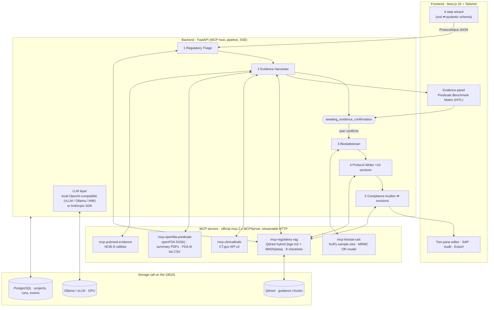

# AI-SaMD Clinical Protocol Copilot 🩺🤖

**MCP-powered clinical trial protocol generator for AI/ML-enabled medical devices — runs entirely on one NVIDIA DGX Spark (GB10).**
**基於 MCP 架構之智慧醫材（AI-SaMD）臨床試驗計畫書輔助草擬系統 — 可完整部署於單台 DGX Spark（GB10）。**

> An MCP-powered web system that drafts regulatory-grade clinical investigation plans for AI/ML-based Software as a Medical Device (AI-SaMD), grounded in ClinicalTrials.gov, FDA 510(k)/De Novo summaries, PubMed baselines and TFDA/FDA/IMDRF guidance, with deterministic biostatistics and checklist-driven compliance auditing (STARD-AI / SPIRIT-AI / ISO 14155).

[](#testing)  

---

## 📖 Overview | 專案簡介

為 AI/ML 醫療器材軟體撰寫符合 **TFDA、US FDA、ISO 14155** 與 **STARD-AI / SPIRIT-AI** 的臨床試驗計畫書，需要同時比對同類上市產品（predicate）的驗證設計、已登錄試驗、文獻基準，並正確推估樣本數。本系統把這個流程拆成 **五個確定性 MCP 工具伺服器 + 五個 LLM agent**：

1. 使用者在網頁精靈填入四組結構化資訊（器材與法規定位、AI 規格與人機流程、研究設計、評估指標與統計假設）。
2. **Triage Agent** 判定法規路徑、風險等級與適用查核表（例如 standalone 研究用 STARD-AI 而不是 SPIRIT-AI）。
3. **Harvester Agent** 平行查詢 ClinicalTrials.gov、openFDA + 510(k) 摘要 PDF、PubMed、法規 RAG，產出 **Predicate Benchmark Matrix** 供使用者勾選確認（human-in-the-loop 閘門）。
4. **Biostatistician Agent** 呼叫 `mcp-biostat-calc`（SciPy，確定性）計算樣本數：精確二項 performance-goal、Buderer、AUROC、McNemar、Obuchowski–Rockette MRMC（Hillis 2011）。
5. **Writer Agent** 以 RAG 條文與實證為依據平行撰寫十章節；**Auditor Agent** 逐項審查查核表並要求回修。
6. 雙欄編輯器修訂後匯出 Markdown / .docx。

**所有數字只能來自工具輸出，所有引用只能來自檢索結果；無法支持的內容一律標記 `[TO BE CONFIRMED]`。**

> 本專案源自一份以 Gemini 先行規劃的設計文件；逐條檢視後的修正紀錄見 [`docs/REVIEW.zh-TW.md`](docs/REVIEW.zh-TW.md)（例如 SPIRIT-AI 適用範圍、TFDA 指引正式名稱、openFDA 無 De Novo、MCP SDK 2.x API 等）。

---

## 🏗️ Architecture | 系統架構



### Why these corrections matter
| Gemini draft | This implementation |
|---|---|
| SPIRIT-AI for every study | Checklist selection by design: **STARD-AI** (standalone / MRMC), **SPIRIT-AI + CONSORT-AI** (prospective RCT), **TRIPOD+AI** (prognostic), **ISO 14155 Annex A** + **IMDRF N41** always, **TFDA** / **FDA CADe** by market |
| LLM-based compliance check inside an MCP server | Deterministic keyword pre-screen in the server; LLM judgement in the backend Auditor with a revision loop |
| `FastMCP` (mcp 1.x) | `MCPServer` from the official `mcp` 2.x SDK; `mcp.client.client.Client` on the host |
| No inference layer | Provider-agnostic LLM client; default = local OpenAI-compatible endpoint on the GB10 with structured-output fallbacks |
| HITL as an arrow | Persisted run state machine with a real `awaiting_evidence_confirmation` stage, SSE events, resumable after restart |

---

## 📂 Repository layout

```
.
├── backend/                     # FastAPI app: schemas, LLM layer, MCP client, 5 agents, pipeline, exporters, tests
│   └── app/{schemas,llm,mcp_client,agents,api,db,exporters}
├── mcp-servers/
│   ├── mcp-biostat-calc/        # deterministic statistics (12 tools) — reference package for conventions
│   ├── mcp-clinicaltrials/      # ClinicalTrials.gov API v2 (4 tools)
│   ├── mcp-openfda-predicate/   # openFDA 510(k), 510(k)/De Novo PDF extraction, FDA AI device list (6 tools)
│   ├── mcp-pubmed-evidence/     # NCBI E-utilities, baseline-performance extraction, citations (5 tools)
│   └── mcp-regulatory-rag/      # Qdrant hybrid retrieval, ingestion CLI, 8 checklist YAMLs (6 tools)
├── frontend/                    # Next.js 16 wizard / evidence panel / editor
├── docker/                      # shared Python Dockerfile, Ollama model-pull helper
├── docker-compose.yml           # full stack for a DGX Spark (profiles: ollama | vllm | ingest)
├── docs/USER_GUIDE.zh-TW.md     # 操作說明 (UI walkthrough with screenshots)
├── docs/SECURITY.zh-TW.md       # 安全性設計、資料邊界、對外開放前檢查清單
├── docs/REVIEW.zh-TW.md         # correctness review of the original plan
├── docs/GB10_DEPLOYMENT.md      # DGX Spark deployment guide + real GB10 主機 deployment record
├── scripts/smoke_test.py        # end-to-end smoke test against a running stack
├── pyproject.toml / uv.lock     # uv workspace (Python ≥ 3.12)
└── .env.example
```

---

## 🚀 Quick start

### A. Full stack on the DGX Spark (GB10)
See **[docs/GB10_DEPLOYMENT.md](docs/GB10_DEPLOYMENT.md)** for the complete guide and **[docs/USER_GUIDE.zh-TW.md](docs/USER_GUIDE.zh-TW.md)** for how to operate the web UI. Short version:
```bash
cp .env.example .env                      # set LLM_MODEL, NCBI_API_KEY, API_KEY (openssl rand -hex 32)
docker compose --profile ollama up -d --build
docker compose --profile ollama run --rm ollama-pull                    # qwen3:32b + bge-m3
docker compose --profile ollama --profile ingest run --rm rag-ingest     # TFDA / FDA / IMDRF guidance → Qdrant
open http://<spark-ip>:3000
```

### B. Local development (any Linux/macOS, no GPU needed for tests)
```bash
uv sync --all-packages --group dev
make test            # all Python tests: unit + in-process MCP integration + full pipeline with fake LLM
make lint
cd frontend && npm ci && npm run build
```
Point the backend at any OpenAI-compatible server (`LLM_BASE_URL`, `LLM_MODEL`) or set `LLM_PROVIDER=anthropic`.

---

## 🔌 MCP tool catalogue

| Server (port) | Tools |
|---|---|
| `mcp-biostat-calc` (8101) | `calc_standalone_sample_size`, `calc_one_sample_proportion`, `calc_buderer_sample_size`, `calc_proportion_ci`, `calc_diagnostic_accuracy`, `calc_two_proportion_sample_size`, `calc_paired_proportion_sample_size`, `calc_auc_sample_size`, `calc_mrmc_power`, `calc_mrmc_sample_size`, `calc_mrmc_reader_case_grid`, `adjust_for_attrition`, `allocate_strata` |
| `mcp-clinicaltrials` (8102) | `search_samd_trials`, `get_trial_protocol_details`, `extract_eligibility_bullets`, `summarize_design_patterns` |
| `mcp-openfda-predicate` (8103) | `find_predicate_devices`, `get_510k_record`, `extract_510k_clinical_summary`, `extract_denovo_clinical_summary`, `search_fda_ai_device_list`, `summarize_predicate_benchmarks` |
| `mcp-pubmed-evidence` (8104) | `search_baseline_performance`, `search_ai_evidence`, `fetch_abstract_citations`, `extract_performance_metrics`, `build_pubmed_query` |
| `mcp-regulatory-rag` (8105) | `retrieve_guideline_clauses`, `list_indexed_documents`, `list_checklists`, `get_checklist`, `select_checklists`, `prescreen_checklist_coverage` |

Every server runs as `python -m <package> --transport stdio` (for Claude Desktop / Claude Code) or `--transport streamable-http --port <n>` (for the backend).

---

## 🧭 Input schema (data contract)

`ProtocolInput` (pydantic, served as JSON Schema at `GET /api/meta/schema`, example at `GET /api/meta/example`):

| Module | Key fields |
|---|---|
| `device_profile` | name/version, `samd_category` (CADe/CADx/CADt/CADe_CADx/Prognostic_Predictive), `target_jurisdictions` (TFDA, US_FDA_510k, US_FDA_DeNovo, US_FDA_PMA, CE_MDR), `product_code`, `predicate_devices[]`, `indications_for_use.clinical_role` (Replace/Add_on/Triage) |
| `ai_specifications` | `algorithm_type` (Locked/Adaptive_PCCP), input modality & quality requirements, `output_format[]`, operating point, `human_ai_workflow`, `training_data_summary.independence_statement` |
| `study_design` | `design_type` (Standalone / MRMC / Hybrid / Prospective RCT), collection mode, sites, `sampling_strategy`, prevalence, `mrmc_config` (readers, washout, fully-crossed, paradigm), `ground_truth_method`, inclusion/exclusion, subgroups |
| `statistical_assumptions` | primary endpoints, hypothesis type, expected vs. goal sensitivity/specificity/AUC, ΔAUC + pilot OR variance components, NI margin, `alpha` + `alpha_sidedness`, power, attrition |

---

## 🧪 Testing

```bash
uv run pytest -q                                   # all packages (importlib mode)
LIVE_API_TESTS=1 uv run pytest -q -m live          # hits ClinicalTrials.gov / openFDA / PubMed for real
```
- `mcp-biostat-calc`: hand-verified closed-form checks, exact-binomial size/power constraints, MRMC monotonicity and null-power sanity.
- `mcp-regulatory-rag`: bilingual tokenizer, in-memory Qdrant hybrid search (zh + en), checklist selection logic, coverage pre-screen.
- `backend`: schema validation, OpenAI-compatible client (json_schema → json_object fallback, retries, `<think>` stripping), **full pipeline end-to-end** with a fake LLM and the real biostat/RAG servers in-process, HITL gate, audit→revision loop, exports.

---

## 🗺️ Status & roadmap

| Phase | Scope | Status |
|---|---|---|
| 1 | Core MCPs (`biostat`, `clinicaltrials`) + CLI verification | ✅ done (plus openFDA, PubMed) |
| 2 | Regulatory RAG (TFDA / FDA / IMDRF + checklists), openFDA summaries | ✅ done — run `rag-ingest` on the GB10 |
| 3 | Web UI, HITL evidence confirmation, editor, export | ✅ first version (Markdown editor; TipTap rich-text is a follow-up) |
| next | Validate MRMC numbers against RJafroc/iMRMC; add MDCG 2020-1 & 人體研究法 texts to the corpus; multi-user auth; PDF export; TipTap editor with tracked changes | ⏳ |

---

## 🔒 Security | 安全性

- **Local-first**: model, vector store and database all run on the GB10; only public keywords (disease, modality, product code, K-number) leave the machine to query ClinicalTrials.gov / openFDA / PubMed. Do not enter identifiable patient data.
- **Minimal exposure**: only the frontend port is published on the LAN; backend, Qdrant and Ollama bind to `127.0.0.1`, PostgreSQL and the MCP servers are not published at all.
- **API key**: set `API_KEY`; the browser talks to a same-origin `/backend` proxy and the Next.js server adds the key, so it never reaches the browser.
- **LLM safety**: retrieved documents are treated as untrusted data (prompt-injection guard), statistics come only from the deterministic biostat server, Markdown is rendered without raw HTML.

Details and a pre-deployment checklist: [`docs/SECURITY.zh-TW.md`](docs/SECURITY.zh-TW.md).

## ⚠️ Disclaimer | 免責聲明

Output is an **AI-assisted draft**. Sample sizes are computed deterministically but MRMC results depend on pilot variance components and must be cross-checked with RJafroc/iMRMC; every section must be reviewed by qualified regulatory, clinical and biostatistics professionals before IRB / TFDA / FDA submission. 本系統產出為 AI 輔助草稿，送件前須由法規、臨床與生統專業人員覆核。

## License
Apache-2.0 — see [LICENSE](LICENSE).
