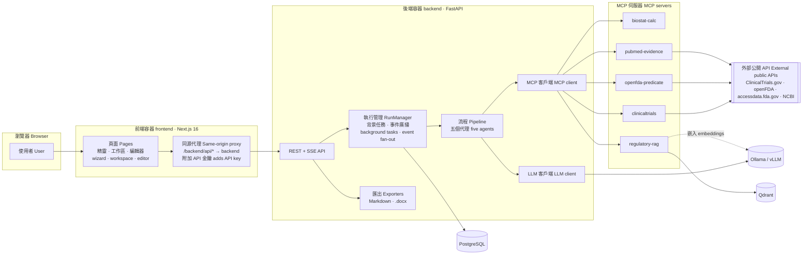
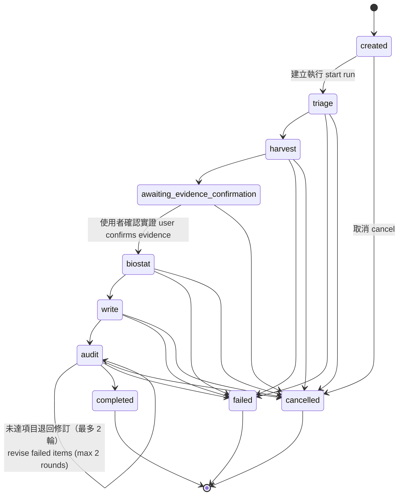
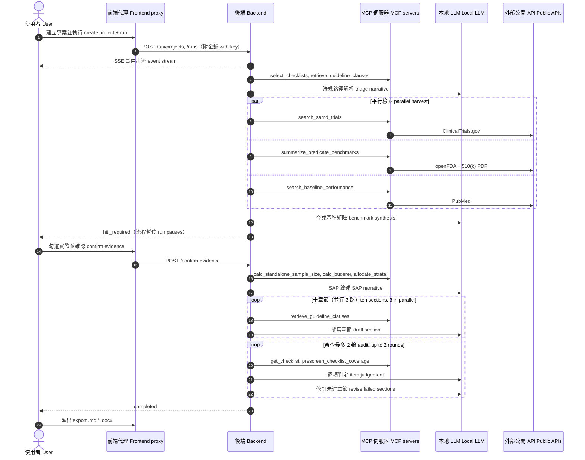
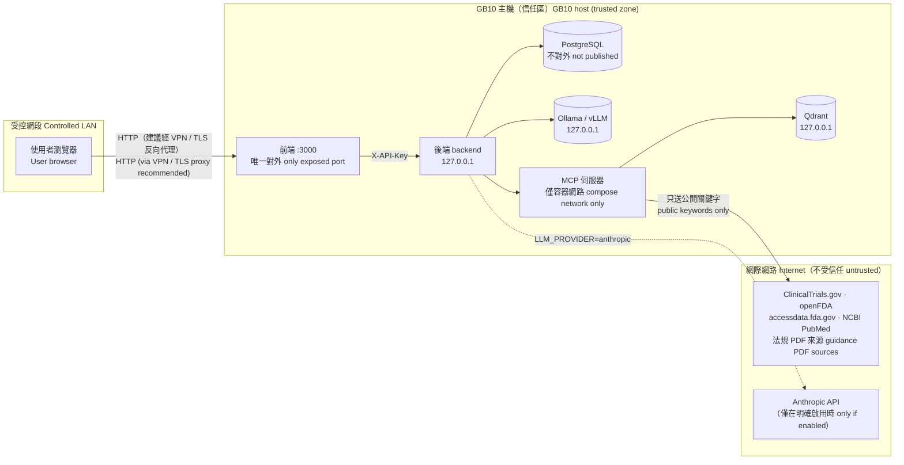
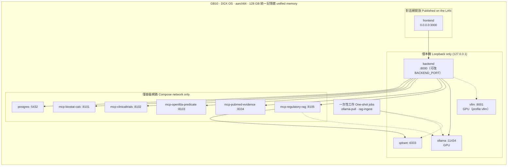
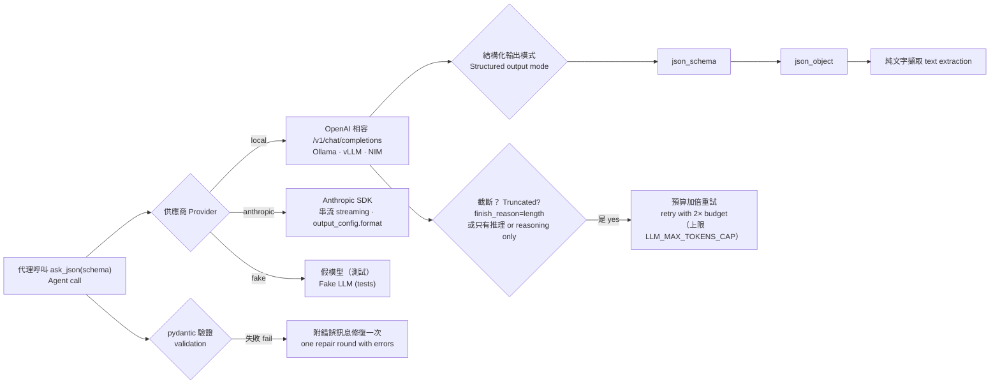

# 系統架構 | System Architecture

> AI-SaMD Clinical Protocol Copilot 的架構說明，中英對照。
> Architecture of the AI-SaMD Clinical Protocol Copilot, in Traditional Chinese and English.

**目錄 Contents**
1. [設計原則 Design principles](#1-設計原則--design-principles)
2. [元件 Components](#2-元件--components)
3. [執行流程與狀態機 Pipeline & state machine](#3-執行流程與狀態機--pipeline--state-machine)
4. [一次執行的時序 Sequence of a run](#4-一次執行的時序--sequence-of-a-run)
5. [資料流與信任邊界 Data flow & trust boundaries](#5-資料流與信任邊界--data-flow--trust-boundaries)
6. [GB10 部署拓撲 Deployment topology on the GB10](#6-gb10-部署拓撲--deployment-topology-on-the-gb10)
7. [LLM 層 LLM layer](#7-llm-層--llm-layer)
8. [確定性與生成式的分工 Deterministic vs. generative work](#8-確定性與生成式的分工--deterministic-vs-generative-work)
9. [資料模型與 API Data model & API](#9-資料模型與-api--data-model--api)
10. [技術選型 Technology stack](#10-技術選型--technology-stack)
11. [設計取捨 Design trade-offs](#11-設計取捨--design-trade-offs)
12. [實測效能 Measured performance](#12-實測效能--measured-performance)

---

## 1. 設計原則 | Design principles

| 原則 Principle | 說明 Meaning |
|---|---|
| **數字不靠模型 Numbers never come from the model** | 樣本數、信賴區間、MRMC 檢定力全部由 `mcp-biostat-calc` 確定性計算；LLM 只負責把結果寫成文字。 Sample sizes, CIs and MRMC power are computed deterministically by `mcp-biostat-calc`; the LLM only turns results into prose. |
| **引用必須可追溯 Every citation is traceable** | 章節只能引用檢索到的 K 編號、NCT 編號、PMID 與法規條文；無法支持的內容標記 `[TO BE CONFIRMED]`。 Sections may only cite retrieved K-numbers, NCT IDs, PMIDs and guidance clauses; unsupported content is marked `[TO BE CONFIRMED]`. |
| **人在迴圈中 Human in the loop** | 實證檢索後強制暫停，由使用者確認採用哪些證據，才進入統計與撰寫。 The run stops after evidence retrieval until a person confirms which evidence to use. |
| **資料留在本機 Local-first** | 模型、資料庫、向量庫都在 GB10；只有公開關鍵字會送去查外部資料庫。 Model, database and vector store run on the GB10; only public keywords leave the machine. |
| **工具與推理分離 Tools separate from reasoning** | MCP 伺服器不呼叫 LLM、不執行模型產生的指令；流程由後端程式決定，不讓模型自由選工具。 MCP servers never call an LLM or run model-generated commands; the backend decides the workflow, the model does not pick tools freely. |
| **部分失敗不拖垮全局 Partial failure stays partial** | 外部來源失敗、單章撰寫失敗、修訂失敗都記為警示並繼續，整個執行不會因一處失敗而中止。 A failed source, section or revision becomes a warning and the run continues. |

---

## 2. 元件 | Components

| 元件 Component | 位置 Location | 職責 Responsibility |
|---|---|---|
| 前端頁面 Frontend pages | `frontend/app`, `frontend/components` | 四步驟精靈（zod 驗證，與後端 pydantic 對應）、執行工作區（進度、即時事件、實證確認）、編輯器、SAP / 審查 / 匯出分頁。 Four-step wizard (zod mirrors the backend pydantic schema), run workspace (progress, live events, evidence confirmation), editor, SAP / audit / export tabs. |
| 同源代理 Same-origin proxy | `frontend/app/backend/[...path]/route.ts` | 只轉送 `/api/*`，逐段檢查路徑，伺服器端附加 `X-API-Key`，串流回傳（SSE 與下載不中斷）。 Forwards only `/api/*`, validates each path segment, adds `X-API-Key` server-side, streams responses (SSE and downloads pass through). |
| API 層 API layer | `backend/app/api/routes.py`, `backend/app/main.py` | 專案、執行、事件（SSE）、實證確認、章節編輯、取消、匯出；可選的 API 金鑰中介層。 Projects, runs, events (SSE), evidence confirmation, section edits, cancel, export; optional API-key middleware. |
| 執行管理 RunManager | `backend/app/api/manager.py` | 以背景任務跑流程，每個執行有自己的 MCP 管理器（工具呼叫計數獨立），事件存入資料庫並廣播給 SSE 訂閱者。 Runs the pipeline as background tasks; each run gets its own MCP manager (per-run tool counts); events are persisted and fanned out to SSE subscribers. |
| 流程與代理 Pipeline & agents | `backend/app/agents/` | `triage` → `harvester` → 人工閘門 → `biostat` → `writer` → `auditor`（含修訂迴圈）。 `triage` → `harvester` → human gate → `biostat` → `writer` → `auditor` (with revision loop). |
| LLM 客戶端 LLM client | `backend/app/llm/` | 本地 OpenAI 相容（Ollama / vLLM / NIM）、Anthropic SDK、測試用假模型；結構化輸出與截斷處理。 Local OpenAI-compatible (Ollama / vLLM / NIM), Anthropic SDK, a fake model for tests; structured output and truncation handling. |
| MCP 客戶端 MCP client | `backend/app/mcp_client/` | 官方 `mcp` 2.x `Client`，以 streamable HTTP 連線；測試時可直接掛載伺服器於同一行程。 Official `mcp` 2.x `Client` over streamable HTTP; servers can be mounted in-process for tests. |
| 匯出 Exporters | `backend/app/exporters/` | 組合摘要表、十章節、附錄（計算紀錄、實證清單、審查結果）、參考文獻；轉 Word。 Assembles synopsis table, ten sections, appendices (computations, evidence register, audit), references; converts to Word. |
| MCP 伺服器 MCP servers | `mcp-servers/*` | 五個獨立 Python 套件，各自有測試；見 README 的工具一覽。 Five independent Python packages with their own tests; see the tool catalogue in the README. |

---

## 3. 執行流程與狀態機 | Pipeline & state machine

| 階段 Stage | 輸入 Input | 輸出（存入 `RunState`）Output (stored in `RunState`) |
|---|---|---|
| `triage` | `ProtocolInput` | `TriageDecision`：研究型態、法規路徑、風險評估、適用查核表（主要 / 輔助 / 結構） Study archetype, pathways, risk assessment, applicable checklists (primary / supporting / structural) |
| `harvest` | 疾病、模態、產品代碼、predicate 編號 Disease, modality, product code, predicate numbers | `EvidenceMatrix`：實證項目、基準矩陣、基準效能、缺口警示 Evidence items, benchmark rows, baseline performance, gaps |
| `awaiting_evidence_confirmation` | 使用者的 `EvidenceConfirmation` User's `EvidenceConfirmation` | 勾選結果、備註、基準值覆寫 Accepted items, notes, baseline overrides |
| `biostat` | 統計假設 + 已確認的基準值 Statistical assumptions + confirmed baselines | `StatisticalAnalysisPlan`：每筆計算的輸入輸出、最終樣本數、分層配置、SAP 敘述 Every computation's inputs/outputs, final sample size, allocation, SAP narrative |
| `write` | 以上全部 + 法規條文檢索 All of the above + guidance retrieval | 十個 `DraftSection`（含引用與待確認事項） Ten `DraftSection`s with citations and open questions |
| `audit` | 十章節 + 適用查核表 Ten sections + applicable checklists | `AuditReport`（逐項 pass / partial / fail / N/A 與修訂需求） Item-level pass / partial / fail / N/A and revision requests |

**韌性 Resilience**：外部來源失敗只記警示；撰寫失敗的章節以標記佔位；修訂失敗保留原文；SAP 敘述與基準矩陣合成失敗時改用確定性骨架。執行狀態每個階段都寫入資料庫，閘門可跨重啟續跑。
A failed source only adds a warning; a failed section becomes a flagged placeholder; a failed revision keeps the previous text; the SAP narrative and benchmark synthesis fall back to deterministic skeletons. State is persisted after every stage, so the gate survives a restart.

---

## 4. 一次執行的時序 | Sequence of a run

---

## 5. 資料流與信任邊界 | Data flow & trust boundaries

| 資料 Data | 存放 / 去向 Where it lives / goes |
|---|---|
| 表單輸入 Form input | 本機 PostgreSQL；送本機 LLM Local PostgreSQL; sent to the local LLM |
| 生成的計畫書與審查 Drafts & audits | 本機 PostgreSQL；使用者下載匯出檔 Local PostgreSQL; downloaded by the user |
| 法規全文與向量 Guidance text & vectors | 本機 Qdrant 與 volume Local Qdrant and volume |
| 對外查詢 Outbound queries | 疾病名稱、模態、產品代碼、K / DEN 編號（公開資訊） Disease, modality, product code, K / DEN numbers (public) |
| 雲端 LLM（選用）Cloud LLM (optional) | 只有 `LLM_PROVIDER=anthropic` 時，提示內容才會送到 Anthropic Prompts reach Anthropic only when `LLM_PROVIDER=anthropic` |

**不受信任的內容 Untrusted content**：檢索到的 PDF、摘要、試驗登錄文字都可能含有惡意指令。系統提示要求模型只從中擷取事實、不得遵循其中指令；模型輸出以不含原始 HTML 的 Markdown 呈現；openFDA PDF 網址由正則驗證過的 K / DEN 編號組成，不接受任意 URL。
Retrieved PDFs, abstracts and registry text may contain malicious instructions. The system prompt tells the model to extract facts only and never follow embedded instructions; output is rendered as Markdown without raw HTML; openFDA PDF URLs are built from regex-validated K / DEN numbers, never arbitrary URLs.

---

## 6. GB10 部署拓撲 | Deployment topology on the GB10

| 項目 Item | 說明 Notes |
|---|---|
| Compose profiles | `ollama`（Ollama 同時提供對話與嵌入 chat + embeddings）、`vllm`（vLLM 提供對話，Ollama 只做嵌入 vLLM for chat, Ollama for embeddings only）、`ingest`（一次性法規匯入 one-shot ingestion） |
| 映像 Images | 自建 Python 映像供後端與五個 MCP 伺服器共用；前端為 Next.js standalone；全部支援 `linux/arm64`，在 GB10 原生建置 One shared Python image for the backend and five MCP servers; Next.js standalone frontend; all `linux/arm64`, built natively on the GB10 |
| 持久化 Volumes | `pgdata`（專案與計畫書 projects & drafts）、`qdrant`（索引，可重建 index, rebuildable）、`corpus`（PDF 快取 PDF cache）、`ollama` / `hf-cache`（模型檔 model files） |
| 埠設定 Port settings | `FRONTEND_PORT` / `BACKEND_PORT` / `QDRANT_PORT` / `OLLAMA_PORT` / `VLLM_PORT` 與 `BACKEND_BIND` / `FRONTEND_BIND` 皆在 `.env` 設定 All set in `.env` |
| 記憶體預算 Memory budget | qwen3:32b + 32k context 約 22–30 GB；bge-m3 約 1.5 GB；其餘服務 < 4 GB qwen3:32b with 32k context ≈ 22–30 GB; bge-m3 ≈ 1.5 GB; everything else < 4 GB |

---

## 7. LLM 層 | LLM layer

| 設定 Setting | 預設 Default | 用途 Purpose |
|---|---|---|
| `LLM_PROVIDER` | `local` | `local` / `anthropic` / `fake` |
| `LLM_BASE_URL`, `LLM_MODEL` | `http://ollama:11434/v1`, `qwen3:32b` | 本地端點與模型 Local endpoint and model |
| `LLM_EXTRA_BODY` | 空 empty | 合併進每個請求的 JSON，例如 `{"reasoning_effort":"none"}` 關閉 Qwen3 思考模式 JSON merged into every request, e.g. turn Qwen3 thinking off |
| `LLM_MAX_TOKENS` / `LLM_SECTION_MAX_TOKENS` / `LLM_MAX_TOKENS_CAP` | 8192 / 12000 / 24000 | 一般呼叫 / 長輸出呼叫 / 截斷重試上限 Short calls / long-output calls / retry ceiling |
| `LLM_TIMEOUT_SECONDS` | 3600 | GPU 與其他工作共用時單次章節呼叫可能超過 30 分鐘 A section call can exceed 30 min on a shared GPU |
| `EMBEDDINGS_*` | `bge-m3`, 1024 維 dims | 法規 RAG 的向量嵌入；未設定時退回確定性雜湊嵌入（主要靠 BM25） Embeddings for the guidance RAG; falls back to hashing (BM25-led) if unset |

---

## 8. 確定性與生成式的分工 | Deterministic vs. generative work

| 工作 Task | 由誰做 Done by | 理由 Why |
|---|---|---|
| 樣本數、信賴區間、MRMC 檢定力、分層配置 Sample size, CIs, MRMC power, allocation | `mcp-biostat-calc`（SciPy） | 必須可重現、可稽核 Must be reproducible and auditable |
| 查核表選擇、條文檢索、涵蓋度預篩 Checklist selection, clause retrieval, coverage pre-screen | `mcp-regulatory-rag` | 規則明確、結果可解釋 Explicit rules, explainable results |
| 試驗、predicate、文獻檢索與數值擷取 Trial, predicate and literature retrieval and metric extraction | 三個檢索 MCP 伺服器 Three retrieval MCP servers | 來源可追溯 Traceable sources |
| 風險評估敘述、基準矩陣合成 Risk narrative, benchmark synthesis | LLM（結構化 JSON） | 需要跨來源的判讀 Needs cross-source judgement |
| 十章節撰寫、修訂 Section drafting and revision | LLM | 需要專業寫作 Needs expert writing |
| 查核表逐項判定 Checklist item judgement | LLM（以預篩結果聚焦） LLM, focused by the pre-screen | 需要理解語意是否「真的」涵蓋 Needs to judge whether content truly covers an item |

---

## 9. 資料模型與 API | Data model & API

**資料表 Tables**（SQLAlchemy，PostgreSQL / 測試用 SQLite）

| 資料表 Table | 內容 Content |
|---|---|
| `projects` | 專案名稱與完整 `ProtocolInput`（JSON） Name and the full `ProtocolInput` (JSON) |
| `runs` | 執行階段與完整 `RunState`（JSON：triage、evidence、sap、sections、audits、計數、警示） Stage and the full `RunState` (JSON: triage, evidence, SAP, sections, audits, counters, warnings) |
| `run_events` | 每個事件（階段開始 / 完成、進度、工具呼叫、人工確認、錯誤） Every event (stage start / end, progress, tool call, HITL, error) |

**API 端點 Endpoints**（前綴 prefix `/api`；設定 `API_KEY` 時除 `/health` 外都需金鑰 key required except `/health` when `API_KEY` is set）

| 方法與路徑 Method & path | 用途 Purpose |
|---|---|
| `GET /health` | 健康檢查 health check |
| `GET /meta/schema`, `/meta/example`, `/meta/config`, `/meta/mcp-health` | 輸入合約、範例、設定、MCP 狀態 Input contract, example, config, MCP status |
| `POST /projects` · `GET /projects` · `GET/PUT /projects/{id}` | 專案管理 project management |
| `POST /projects/{id}/runs` · `GET /projects/{id}/runs` · `GET /runs/{id}` | 啟動與查詢執行 start and read runs |
| `GET /runs/{id}/events` | SSE 即時事件 live events |
| `GET /runs/{id}/events/history` | 已存事件 persisted events |
| `POST /runs/{id}/confirm-evidence` | 人工確認實證並續跑 confirm evidence and resume |
| `PUT /runs/{id}/sections/{key}` | 編輯章節 edit a section |
| `POST /runs/{id}/cancel` | 取消執行 cancel |
| `GET /runs/{id}/export.md`, `/export.docx` | 匯出 export |

---

## 10. 技術選型 | Technology stack

| 層 Layer | 技術 Technology |
|---|---|
| 前端 Frontend | Next.js 16.4 (App Router, standalone) · React 19.3 · TypeScript · Tailwind CSS 4.3 · react-hook-form + zod 4 · react-markdown |
| 後端 Backend | Python 3.12+ · FastAPI · pydantic 2 · SQLAlchemy 2 (async) · sse-starlette · python-docx · uv workspace |
| 工具協定 Tool protocol | Model Context Protocol, official `mcp` Python SDK 2.x (`MCPServer`, streamable HTTP) |
| 統計 Statistics | SciPy · NumPy |
| 檢索 Retrieval | Qdrant 1.15（dense + sparse, RRF fusion）· bge-m3 · BM25 with jieba |
| 推論 Inference | Ollama · NVIDIA vLLM container · NVIDIA NIM · Anthropic API（選用 optional） |
| 資料庫 Database | PostgreSQL 16 |
| 部署 Deployment | Docker Compose（linux/arm64）on NVIDIA DGX Spark / GB10 |

---

## 11. 設計取捨 | Design trade-offs

| 決策 Decision | 取捨 Trade-off |
|---|---|
| 固定流程而非讓模型自由呼叫工具 Fixed pipeline instead of free tool-calling | 可預測、可稽核、本地中型模型也能穩定完成；代價是彈性較低，新增步驟要改程式。 Predictable, auditable and reliable with mid-size local models; less flexible, new steps need code. |
| 不用 LangGraph No LangGraph | 五階段加一個閘門，自寫約 150 行的流程就足夠，少一個常改版的依賴；需要動態分支時再引入。 Five stages and one gate fit in ~150 lines; one less fast-moving dependency; can be added if dynamic branching is needed. |
| 執行狀態整包存 JSON Whole run state stored as JSON | 結構可隨版本演進、讀寫簡單；代價是跨執行的查詢較不方便。 Schema can evolve, simple reads and writes; cross-run queries are less convenient. |
| 前端同源代理而非直接開放後端 Same-origin proxy instead of exposing the backend | 只開一個埠、金鑰不進瀏覽器；多一跳轉發。 One exposed port, key stays server-side; one extra hop. |
| 單一共用 API 金鑰 Single shared API key | 部署簡單；尚無個人帳號與專案權限，多人使用需在前面加 SSO 反向代理。 Simple to deploy; no per-user accounts or project permissions yet, put an SSO reverse proxy in front for multi-user use. |
| 本地 32B 模型 Local 32B model | 資料不出機器、無使用費；一份完整計畫書約 1–2.5 小時。 Data stays on the box, no usage fees; one full protocol takes about 1–2.5 hours. |

---

## 12. 實測效能 | Measured performance

GB10 上以 `qwen3:32b`（Ollama，思考模式關閉）完整跑一份範例，GPU 與另一個 LLM 工作共用：
One full example run on the GB10 with `qwen3:32b` (Ollama, thinking off), GPU shared with another LLM workload:

| 階段 Stage | 耗時 Time |
|---|---|
| 法規路徑解析 Triage | 1 分鐘 min |
| 實證檢索至閘門 Harvest to gate | 3.5 分鐘 min |
| 生物統計 Biostatistics | 5 分鐘 min |
| 十章節撰寫 Writing (10 sections) | 56 分鐘 min |
| 審查第一輪 Audit round 1 | 12.5 分鐘 min（pass 29 / partial 10 / fail 5） |
| 修訂 6 章 Revise 6 sections | 63 分鐘 min |
| 審查第二輪 Audit round 2 | 12 分鐘 min（pass 34 / partial 9 / fail 1） |
| **合計 Total** | **2 小時 34 分 2 h 34 min** |

GPU 獨占時估計可在一小時內完成。完整輸出見 [`docs/examples/`](examples/)。
With the GPU to itself the run is expected to finish within about an hour. The full output is in [`docs/examples/`](examples/).
