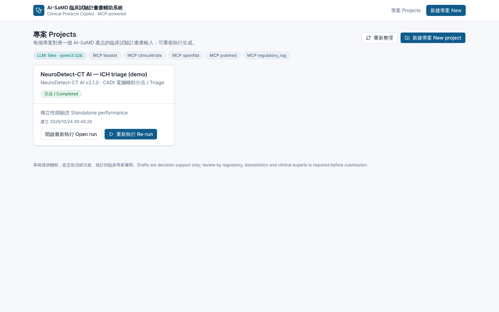
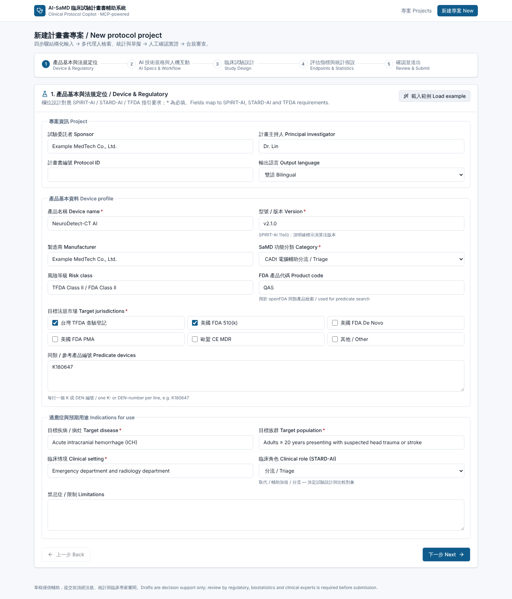
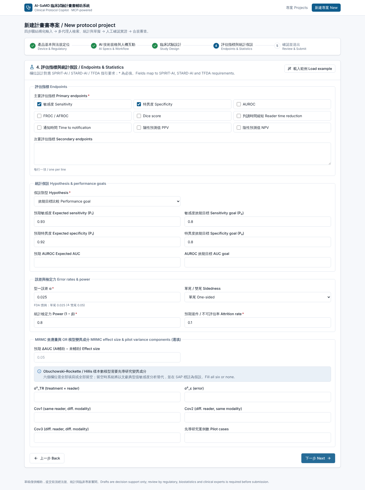
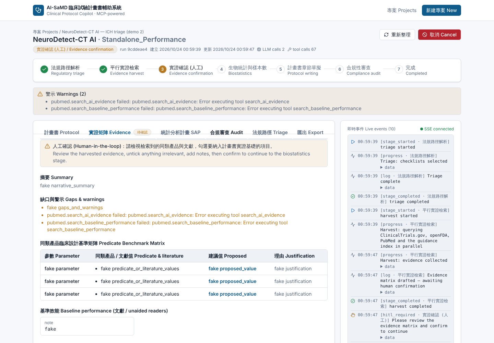
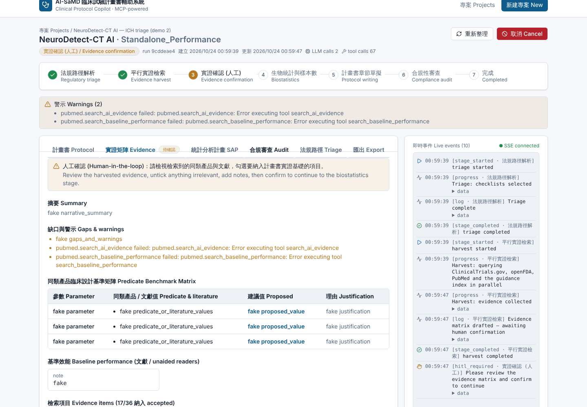
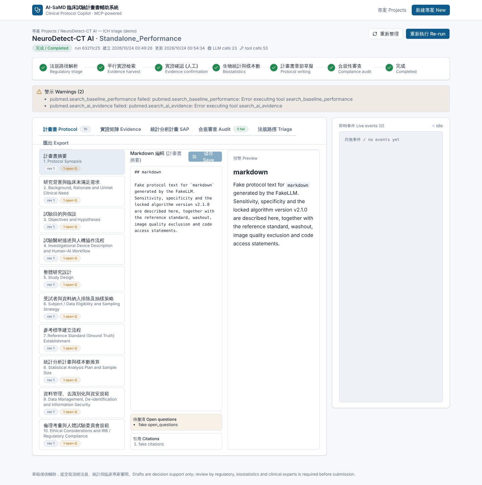
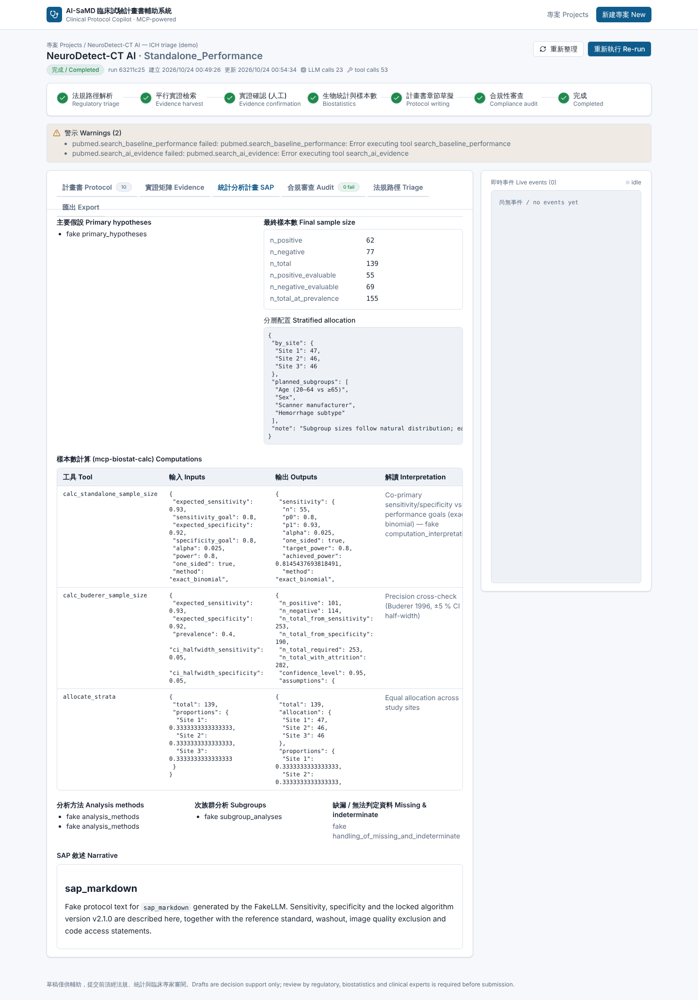
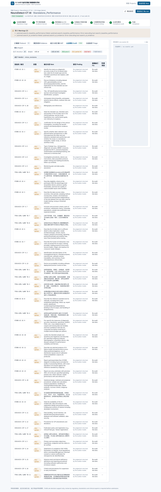
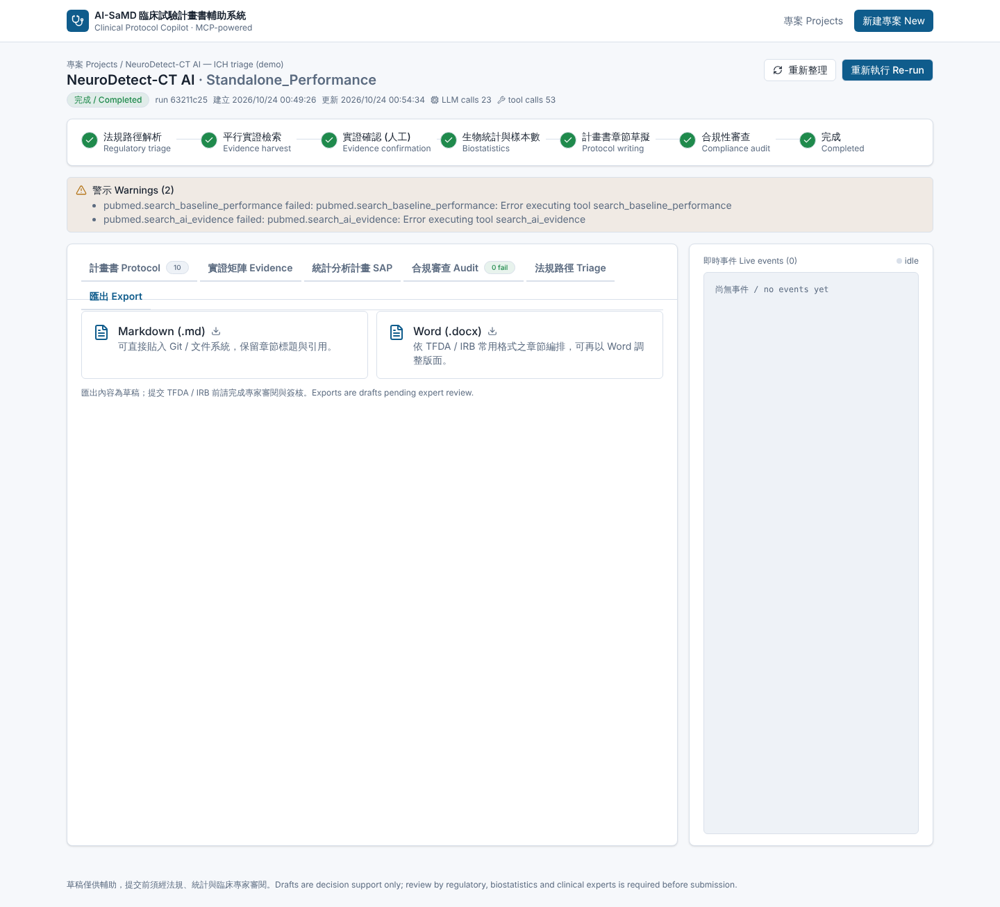

# 操作說明 — AI-SaMD 臨床試驗計畫書輔助系統

> 適用對象：法規 / 臨床 / 生統人員，以及負責維運 GB10 的同仁。部署與維運細節另見 [`GB10_DEPLOYMENT.md`](GB10_DEPLOYMENT.md)。
> 截圖為實際系統畫面（示範時以測試用假模型產生內文，故章節文字為佔位字；在 GB10 上接本地模型後即為真實內容）。

---

## 0. 三分鐘看懂整個流程

```
填寫四步驟表單 ──▶ ① 法規路徑解析 ──▶ ② 平行實證檢索 ──▶ ③ 實證確認（人工，流程在此暫停）
                                                                     │ 你勾選要採用的同類產品 / 文獻並確認
                                                                     ▼
              匯出 .md / .docx ◀── 編輯器修訂 ◀── ⑥ 合規審查 ◀── ⑤ 十章節撰寫 ◀── ④ 生物統計與樣本數
```

| 階段 | 系統做什麼 | 你要做什麼 |
|---|---|---|
| ① 法規路徑解析 | 判定研究型態（standalone / MRMC / RCT）、適用法規路徑、風險等級、該用哪些查核表（STARD-AI、SPIRIT-AI、ISO 14155、TFDA…） | 無 |
| ② 平行實證檢索 | 同時查 ClinicalTrials.gov、openFDA 510(k) 摘要 PDF、FDA AI 器材清單、PubMed、法規條文索引，整理成「同類產品臨床設計基準矩陣」 | 無 |
| ③ 實證確認 | **暫停等你** | 檢視矩陣、勾掉不相關的項目、必要時覆寫基準值、按「確認實證並繼續」 |
| ④ 生物統計 | 呼叫確定性統計工具算樣本數（精確二項、Buderer、AUROC、MRMC OR 模型…），寫統計分析計畫 | 無 |
| ⑤ 十章節撰寫 | 依 ISO 14155 Annex A 結構、引用法規條文與實證，平行撰寫十章 | 無（最耗時，本地 32B 模型約 30–40 分鐘） |
| ⑥ 合規審查 | 逐項對照查核表，未達者退回修訂，最多兩輪 | 無 |
| 完成 | 進入編輯器 | 逐章審閱、修改、匯出 |

**一次完整執行在 GB10 本地 32B 模型上約 1.5–2 小時**，可以關掉瀏覽器，流程在後端持續跑，之後回到「專案」頁點「開啟最新執行」即可。

---

## 1. 進入系統

瀏覽器開啟 `http://<GB10-IP>:3000`（IP 向維運人員索取；只有前端埠對區網開放，後端與資料庫僅本機可達）。若設定了 API 金鑰，瀏覽器不需要知道它，前端伺服器會代為附上。



- 上方的標籤顯示目前接的 LLM 與五個 MCP 伺服器是否已設定。
- 每個專案一張卡片：顯示器材名稱、功能分類、研究型態、最新執行的狀態。
- **開啟最新執行**：進入工作區；**重新執行**：以同一份輸入再跑一次（例如換了模型或更新了法規索引之後）。

---

## 2. 新建專案（四步驟精靈）

點右上角「新建專案 New project」。右上角的「**載入範例 Load example**」會填入一個 ICH 分流（CADt）的完整範例，建議第一次先用範例跑一遍。



### 步驟 1 — 產品基本與法規定位
| 欄位 | 填寫要點 |
|---|---|
| 產品名稱 / 型號版本 | 版本號會寫進計畫書（SPIRIT-AI 11a(i) 要求明確標示演算法版本） |
| SaMD 功能分類 | CADe 偵測 / CADx 診斷 / CADt 分流 / CADe+CADx / 預後或風險預測 |
| 目標法規市場 | 可複選：TFDA、FDA 510(k)、De Novo、PMA、CE MDR。影響適用的查核表與法規條文檢索 |
| FDA 產品代碼 | 例如 QAS（ICH 分流）。有填會用它在 openFDA 找同類產品；沒填就用疾病關鍵字找 |
| 同類 / 參考產品編號 | 一行一個 K 或 DEN 編號。系統會下載其 510(k) / De Novo 摘要 PDF 並擷取臨床驗證設計 |
| 目標疾病、族群、臨床情境 | 用於檢索與撰寫背景章節 |
| 臨床角色 | 取代 / 輔助加值 / 分流。決定比較對象與研究設計（STARD-AI 要求） |

### 步驟 2 — AI 技術規格與人機互動
| 欄位 | 填寫要點 |
|---|---|
| 演算法類型 | 鎖定型 Locked 或自適應 Adaptive/PCCP |
| 輸入模態與品質要求 | 例如「非顯影頭部 CT，切厚 ≤ 5 mm，排除嚴重移動偽影」；會寫進資料層級納入排除條件 |
| 相容設備廠牌 | 用於次族群分析規劃 |
| 輸出形式 | 可複選：邊界框、分割、熱力圖、機率分數、二元分類、分流警示… |
| 操作點說明 | 閾值是否在驗證前鎖定 |
| 預期使用者、人機流程 | Standalone / 同步閱片 / 第二閱片 / 工作清單分流 |
| 訓練資料摘要與獨立性聲明 | STARD-AI 與 TFDA 都要求測試資料獨立於訓練 / 調參資料 |

### 步驟 3 — 臨床試驗設計
| 欄位 | 填寫要點 |
|---|---|
| 研究型態 | Standalone 獨立效能 / MRMC 閱片試驗 / 兩者混合 / 前瞻介入性 RCT。**選 MRMC 或混合時必填 MRMC 設定** |
| 資料收集 | 回溯 / 前瞻 / 混合 |
| 中心數與國家 | 用於分層配置與本土資料說明 |
| 抽樣策略與盛行率 | 連續 / 隨機 / 富集病例對照；研究集內的陽性比例與母群盛行率會影響樣本數換算 |
| MRMC 設定 | 閱片醫師數、資歷、洗脫期週數、完全交叉或 split-plot、閱片順序 |
| 參考標準 | 專家共識 / 病理 / 追蹤結果 / 複合；小組人數、是否對 AI 結果盲化 |
| 納入 / 排除條件、次族群分層 | 一行一項 |

### 步驟 4 — 評估指標與統計假設
| 欄位 | 填寫要點 |
|---|---|
| 主要指標 | 敏感度、特異度、AUROC、FROC、Dice、閱片時間、通知時間… |
| 假設類型 | 效能目標比較（FDA 常用）/ 優效 / 不劣效 |
| 預期值與效能目標 | 例如預期敏感度 0.93、目標 0.80；**兩者必須成對填寫** |
| MRMC 效應量與 pilot 變異成分 | ΔAUC 與 OR 模型六個變異成分（來自 pilot 閱片研究）。沒有 pilot 資料時系統會用「示意值」並在 SAP 大聲標示 |
| α 與單雙尾、檢定力、退件率 | 預設單尾 0.025、power 0.80、退件率 10% |



每一步按「下一步」會即時驗證；最後「確認並送出」會建立專案並立即開始執行，自動跳到工作區。

---

## 3. 工作區：追蹤執行與實證確認



- **進度條**：七個階段，目前階段以橘色標示。
- **警示 Warnings**：外部資料源失敗（例如 PubMed 限流）、假設性的佔位值等都會列在這裡，請在送件前逐條處理。
- **即時事件**：右側顯示每個階段與每一次工具呼叫（可展開看參數），SSE 斷線時會自動改為每 6 秒輪詢。
- **取消 Cancel**：中止目前執行（已完成的階段會保留在紀錄裡）。

### 實證確認（Human-in-the-loop）
流程會在「實證確認」停下來，直到你按下確認：



1. **摘要與缺口警示**：模型對檢索結果的總結，以及它認為缺少的證據。
2. **同類產品臨床設計基準矩陣**：每個設計參數（樣本數、閱片醫師數、參考標準、主要指標…）列出同類產品 / 文獻的值、系統建議值與理由。
3. **基準效能**：由文獻擷取的未輔助判讀敏感度 / 特異度等；數值欄可直接改寫，改寫值會用於後續樣本數計算（例如 RCT 的對照組比例）。
4. **檢索項目**：依來源（ClinicalTrials.gov、openFDA、PubMed、法規條文）分組，每筆可勾選是否採用、加備註；僅勾選的項目會進入撰寫階段。openFDA 從產品代碼搜到但未指定為 predicate 的器材預設不勾選。
5. 填寫審閱者備註，按 **「確認實證並繼續 Confirm & continue」**。

> 確認之後無法回頭修改實證；若要改，請在專案頁「重新執行」。

---

## 4. 完成後：編輯、檢視統計與審查、匯出

### 計畫書 Protocol 分頁（編輯器）


- 左欄十個章節（中英標題），顯示修訂次數與待釐清問題數。
- 中欄 Markdown 編輯，按「儲存」寫回；右欄即時預覽。
- 每章下方列出 **待釐清 Open questions**（文中以 `[TO BE CONFIRMED]` 標記）與 **引用 Citations**（法規條文、predicate、文獻）。
- 章節順序對應 ISO 14155 Annex A：摘要、背景、目的與假設、器材與人機流程、研究設計、納入排除與抽樣、參考標準、統計分析計畫、資料管理與資安、倫理與 IRB。

### 統計分析計畫 SAP 分頁


- **最終樣本數**：陽性 / 陰性 / 總數（含退件率膨脹）、可評估數、依盛行率換算的連續收案總數。
- **分層配置**：各中心配額與預定次族群。
- **樣本數計算**：每一筆都列出呼叫的工具、輸入、輸出與解讀，可直接貼進計畫書附錄或交給生統覆核。所有數字皆由 `mcp-biostat-calc` 確定性計算，不是模型估的。
- **SAP 敘述**：模型依上述數字撰寫的統計章節。

### 合規審查 Audit 分頁


- 可切換審查輪次、查核表（STARD-AI、ISO 14155、TFDA…）與狀態篩選。
- 每項顯示判定（pass / partial / fail / N/A）、發現與建議修正、對應章節。
- 第一輪未達的項目會自動退回撰寫代理修訂並跑第二輪；仍未達者需人工處理。

### 匯出 Export 分頁


- **Markdown (.md)**：含摘要表、法規路徑摘要、十章節、附錄 A（樣本數計算紀錄）、附錄 B（實證清單）、附錄 C（審查結果）、參考文獻、產生過程警示。
- **Word (.docx)**：同內容轉成 Word，可再依院內 / TFDA 模板調整版面。

---

## 5. 常見問題

| 問題 | 說明 |
|---|---|
| 章節內容出現 `[TO BE CONFIRMED]` | 代表輸入或檢索結果不足以支持該敘述，模型被要求不得杜撰；請補資料後重新執行或手動填寫 |
| 警示說 PubMed 查詢失敗 | 多半是 NCBI 限流或網路；在 `.env` 填 `NCBI_API_KEY` 可提高到 10 req/s，再「重新執行」 |
| MRMC 樣本數旁標示 ILLUSTRATIVE | 沒有提供 pilot 變異成分，系統用示意值；送件前務必用 pilot 資料重算並以 RJafroc / iMRMC 交叉驗證 |
| 執行很久沒動 | 撰寫與審查階段每次模型呼叫可能 3–11 分鐘（本地 32B 模型）。看右側事件面板是否持續有新事件；完全停住超過 30 分鐘再找維運 |
| 想換模型或換語言 | 模型在 `.env`（`LLM_MODEL` / `LLM_BASE_URL`）改後重啟 backend；輸出語言在步驟 1「輸出語言」選擇（繁中 / 英文 / 雙語） |
| 資料會外流嗎 | 預設全部在 GB10 本機：模型、向量庫、資料庫都在機器上。只有查詢公開資料庫（ClinicalTrials.gov、openFDA、PubMed）會送出疾病 / 模態等關鍵字，不含病人資料 |

---

## 6. 維運快速參考（GB10）

```bash
cd ~/Clinical-trials-agent                      # 部署時 clone 的位置
docker compose --profile ollama ps              # 看 11 個服務狀態
docker compose --profile ollama logs -f backend # 後端 log（模型呼叫、工具呼叫、錯誤）
docker compose --profile ollama restart backend # 改 .env 後重啟
docker compose --profile ollama --profile ingest run --rm rag-ingest   # 更新法規索引
docker compose --profile ollama down            # 停止（資料保留在 volume）
```

健康檢查：`curl http://localhost:8000/api/health`、`curl http://localhost:8000/api/meta/mcp-health`（五個 MCP 都應為 ok）。

> 系統輸出為 **AI 輔助草稿**，送 IRB / TFDA / FDA 前必須由法規、臨床與生統專業人員逐章覆核。
